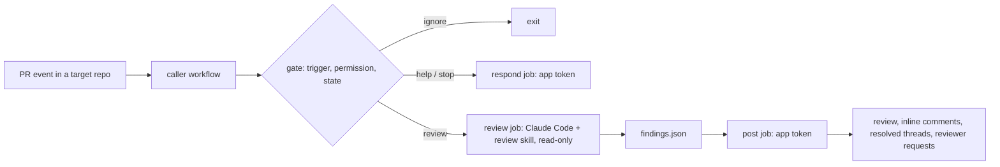

# reviewer

Pull request review by Claude Code, run in GitHub Actions when someone asks for it.

## What it does

- Reviews a pull request only on request: a team review request or a comment command. Pushes never start a review.
- Runs Claude Code headless with a multi-agent review skill. The `code-reviewer` agent always runs; language and security specialists join when the changed files call for them.
- Posts one GitHub review per run. Each finding is graded **blocker**, **follow-up** or **nit**, with evidence and a suggested fix.
- Derives the verdict from fixed rules, not from the model. Any blocker requests changes.
- Approves only low-risk PRs: no blockers, green CI, no high-risk paths, not from a fork or a bot, and approvals switched on for the repo.
- Escalates to the code owners in `CODEOWNERS` when a change needs a human: a blocker on an owned path, high risk, or a design question.
- Re-reviews only the new commits when asked again, resolves the threads of fixed findings, and takes feedback on its findings.

The bot posts as a GitHub App you create. This repository's examples use the app `neralabs-reviewer` (handle `@neralabs-reviewer`) and the team `@neralabs/reviewer`.

## How it works



The model reads untrusted PR content, so it never holds a credential that can write. The review job has no GitHub token and no shell; it produces `findings.json` and nothing else. A separate post job validates and sanitises that output, re-reads the PR from GitHub, applies the verdict rules and posts. Details: [docs/architecture.md](docs/architecture.md) and [docs/security-model.md](docs/security-model.md).

## Quickstart

These steps set the reviewer up for your organization. Replace `<org>` with your organization and `<app>` with your app's name.

1. **Create a GitHub App** in your organization (Settings → Developer settings → GitHub Apps). Permissions:
   - Repository: **Pull requests** read and write, **Contents** read, **Metadata** read.
   - Organization: **Members** read. GitHub ignores an app's changes to team review requests without it.
   - No webhook: clear "Active" under Webhook.

   Generate a private key. Note the app's client ID.
2. **Install the app** on each repository it should review. It needs access to those repositories only.
3. **Create a team** for review requests, for example `<org>/reviewer`. Remove every member, including yourself (GitHub adds the creator), and turn notifications off. Give the team read access to each target repository, so it can be requested as a reviewer.
4. **Store the credentials** as organization or repository settings visible to the target repositories:
   - variable `REVIEWER_APP_CLIENT_ID`: the app's client ID;
   - secret `REVIEWER_APP_PRIVATE_KEY`: the app's private key;
   - the model credential: secret `REVIEWER_ANTHROPIC_API_KEY` (a Claude API key), or secret `REVIEWER_BEDROCK_API_KEY` (an Amazon Bedrock API key). Scope the key to invoking the model you configure and nothing else. [infra/bedrock.yml](infra/bedrock.yml) is a CloudFormation example for Bedrock.
5. **Add the caller workflow.** Copy [templates/caller.yml](templates/caller.yml) to `.github/workflows/reviewer.yml` in the target repository. Set `provider` and `model`, pin `uses:` and `reviewer_ref` to a release tag ([docs/versioning.md](docs/versioning.md)), and set `team_slug`, `handle` and `bot_login` for your app and team ([docs/configuration.md](docs/configuration.md)). Keep the explicit `secrets:` list; don't use `secrets: inherit`.
6. **Add a `REVIEW.md`** at the repository root, from [templates/REVIEW.md](templates/REVIEW.md): what the repo is, what blocks a merge, known gaps, high-risk paths, and the settings block.
7. **Add a `CODEOWNERS`** file. Escalations go to the owners it names. Without one, the bot mentions the repository admins and reports the missing file.

Start with `allow_approve: false`. The bot then comments and requests changes but never approves. Turn approvals on once its reviews are reliable for the repository. Bot approvals count toward required reviews, so treat the caller, `REVIEW.md` and `CODEOWNERS` as security-relevant files.

## Commands

Only users with write access to the repository can trigger the bot. It ignores bots, quoted lines and fenced code.

| Command | Effect |
|---|---|
| Request the team (`@<org>/<team_slug>`) as a reviewer | Review the PR once. The bot then removes the request, so request the team again for another review. |
| `@<app> review` | Review the current head. On a PR reviewed before, only the commits since the last review; on the same head, a re-check of the earlier findings. |
| `@<app> review full` | A fresh full review of the whole PR, also over the large-PR limit. |
| `@<app> rereview <feedback>` | Re-review the current head, using the feedback. `re review` works too. |
| `@<app> stop` | Withdraw the bot's approval, remove the team review request, and cancel a review in progress. |
| `@<app> help` | Reply with the command list. |
| A reply mentioning `@<app>` in one of the bot's finding threads | Feedback on that finding, and a re-review that uses it. |

Commands addressed to the team (`@<org>/<team_slug> review`) work like commands to the app. Draft PRs are reviewed only on an explicit request. See [docs/architecture.md](docs/architecture.md) for re-review and feedback.

## Costs and limits

- Each run passes `max_budget_usd` (default 15) to Claude Code as a spend cap, and the review job times out after 30 minutes.
- A PR with more changed lines than the summary-only threshold (default 50,000, excluding generated files) gets a summary-only pass unless someone asks for `review full`. The caller input `large_pr_lines` sets the threshold; a repository's `REVIEW.md` can override it.
- Each run writes its token cost and duration, at list prices, to the job summary. Your provider's bill is the authority.
- Set a spend limit with your provider as well. The Bedrock example includes a monthly budget that blocks the key at the limit.

## Repository layout

```
.github/workflows/review.yml   reusable workflow: gate, review, post, respond, report-failure
skill/review/SKILL.md          multi-agent review skill
skill/review/team-context.md   review bar shared by every target repository
agents/                        vendored ECC reviewer agents (MIT)
prompts/review.md              first review
prompts/rereview.md            delta review plus feedback
schema/findings.schema.json    contract between the review job and the poster
poster/                        gate, context preparation, posting (TypeScript run directly by Node 24)
scripts/run-claude.sh          the locked-down claude -p invocation
infra/bedrock.yml              CloudFormation example: a scoped Bedrock key user and a monthly budget
templates/caller.yml           caller workflow that target repositories copy
templates/REVIEW.md            REVIEW.md template
docs/                          architecture, security model, configuration, privacy, versioning
```

## Contributing

See [CONTRIBUTING.md](CONTRIBUTING.md) and the [Code of Conduct](CODE_OF_CONDUCT.md). Open an issue before a pull request.

## Security

Report vulnerabilities privately as described in [SECURITY.md](SECURITY.md). The threat model is in [docs/security-model.md](docs/security-model.md); what the reviewer sends to the model provider and keeps is in [docs/privacy.md](docs/privacy.md).

## License

Apache-2.0, see [LICENSE](LICENSE). The six agent prompts vendored from ECC in `agents/` stay under the MIT licence; see [agents/README.md](agents/README.md) and [THIRD_PARTY_NOTICES](THIRD_PARTY_NOTICES).
